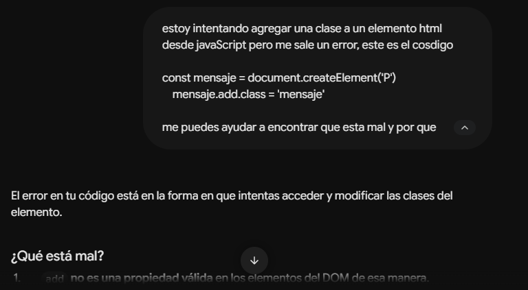
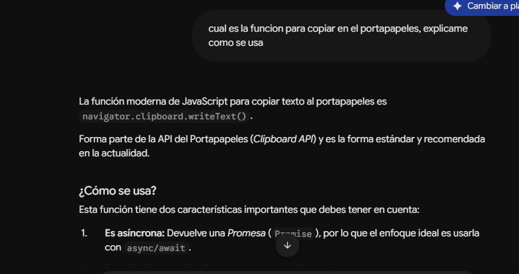
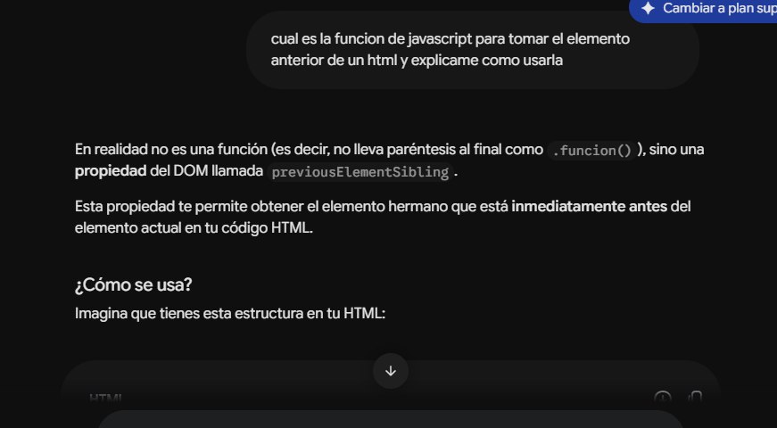
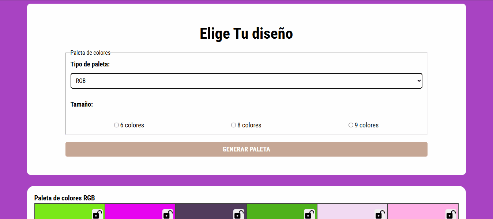
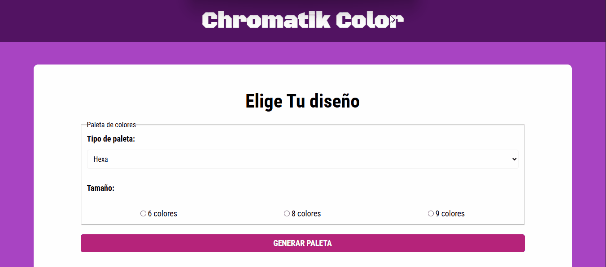
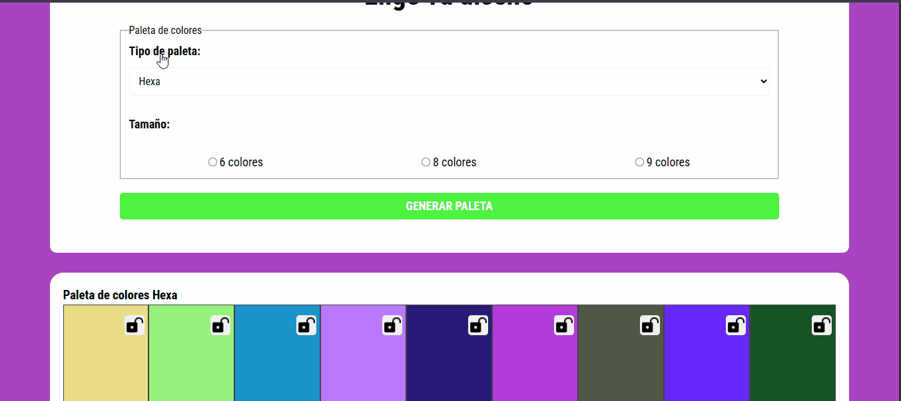
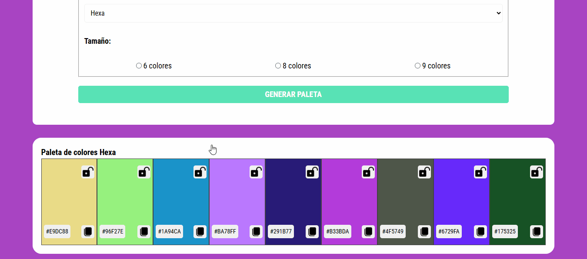
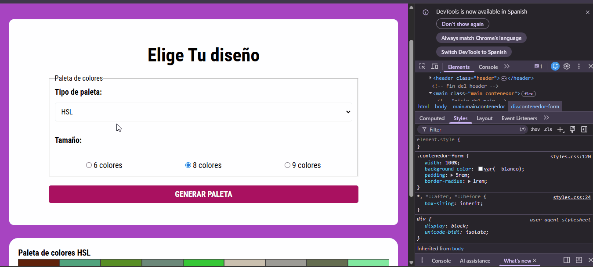
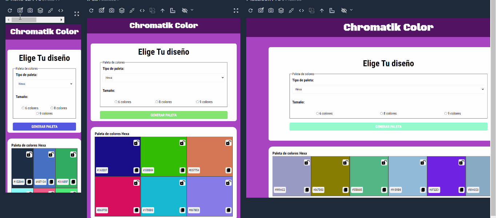

# Chromatik Color

## 1. Descripción

Chromatik Color es una aplicación web que permite generar paletas de colores aleatorias de forma sencilla. El usuario puede seleccionar el formato de color (HEX, RGB o HSL) y la cantidad de colores que desea visualizar (6, 8 o 9).

La aplicación también permite copiar el valor de un color al portapapeles y bloquear colores específicos para conservarlos cuando se genere una nueva paleta. Las paletas y los colores bloqueados se almacenan en el navegador mediante `localStorage`, por lo que permanecen disponibles al volver a abrir la aplicación en el mismo navegador.

## 2. Link del despliegue

https://shuan6991.github.io/ProyectoM1_Georgeshuan_Bolanos/


### Requisitos

- Un navegador web actualizado (Google Chrome, Microsoft Edge, Firefox, etc.).

### Ejecución

Abre el link de despliegue, selecciona un tipo de paleta y un tamaño y se te generara una paleta de colores aleatoria, ademas podras copiar el color y bloquearlo en caso de ser necesario


## 3. Pasos para realizar el despliegue

### Despliegue mediante GitHub Pages

1. Inicia sesión en GitHub y crea un repositorio nuevo.
2. Sube al repositorio los archivos del proyecto: `index.html`, `css/`, `js/` e `img/`. 
3. Verifica que `index.html` esté en la raíz del repositorio.
4. Entra a Settings del repositorio.
5. Abre la sección Pages.
6. En Build and deployment, selecciona Deploy from a branch.
7. Selecciona la rama principal y la carpeta `/ (root)`.
8. Guarda los cambios y espera a que GitHub Pages publique el sitio.
9. Abre el enlace publicado y comprueba que carguen correctamente los estilos, las imágenes y las funciones de la aplicación.

## 4. Decisiones técnicas

- HTML5: estructura y contenido de la interfaz.
- CSS3: diseño visual, distribución de elementos, colores y adaptación a distintos tamaños de pantalla.
- JavaScript: generación de colores, manejo del formulario, actualización dinámica de la interfaz y eventos.
- DOM: actualización de la paleta y asociación de eventos a los controles de copiar y bloquear.
- localStorage: persistencia en el navegador de las paletas generadas y de los colores bloqueados.
- Clipboard API: copia de los valores de color al portapapeles mediante `navigator.clipboard.writeText()`.
- Google Fonts: uso de las tipografías Black Ops One y Roboto Condensed.
- Normalize.css: normalización de estilos predeterminados entre navegadores.

## 5. Mejoras

### Funcionalidades implementadas

- Generación aleatoria de colores en formatos HEX, RGB y HSL.
- Selección de paletas de 6, 8 o 9 colores.
- Copia del valor de cada color al portapapeles.
- Bloqueo y desbloqueo individual de colores para conservarlos al generar otra paleta.
- Recuperación de las paletas guardadas según el formato seleccionado.
- Almacenamiento local de los datos mediante `localStorage`.
- Diseño adaptable a diferentes tamaños de pantalla.

### Mejoras futuras sugeridas

- Permitir exportar una paleta como imagen, archivo CSS o JSON.
- Incorporar un botón para copiar todos los colores de una paleta.
- Añadir nombres descriptivos y contraste de texto para mejorar la accesibilidad.
- Permitir guardar varias paletas favoritas y cambiarles el nombre.


## 6. Documentación de uso de IA

Se utilizo Gemini para correccion de errores en el codigo y explicacion de codigo existente

### Registro de prompts





## 7. Flujo de la aplicación

### 1. Pantalla inicial y tipo de paleta donde muestra colores iniciales en cada tipo



### 2. Se escoge el tipo y el tamañode la paleta y se le da en el boton generar paleta, la paleta se mostrara en la parte de abajo




### 2. Bloqueo de color, si se desea bloquear un color que nos gusto le damos en el candado abierto, el candado cambiara a un candado cerrado y si generamos otra paleta el color seguira mostrandose




### 3. Copiado en el portapapeles, si damos clic en el icono de copiar se copiara el color y mostrara un mensaje de color copiado



### 4. colores persistentes, las ultimas paletas generadas de cada tipo se guardan en localStorage lo que permite ver las paletas asi recargue la pagina o halla cambiado de tipo



### 5. diseño responsive, la aplicacion se adapta a diseño de celular o tablet en caso de que la quieras ver en uno de esos dispositivos



## 8. Estructura del proyecto

```text
ProyectoM1_Georgeshuan_Bolanos/
├── index.html
├── css/
│   ├── normalize.css
│   └── styles.css
├── js/
│   └── js.js
└── img/
    ├── candado-abierto.png
    ├── candado-cerrado.png
    └── copiar.png
```

---

Proyecto: Chromatik Color  
Tecnologías: HTML, CSS y JavaScript  
Tipo: Aplicación web estática
